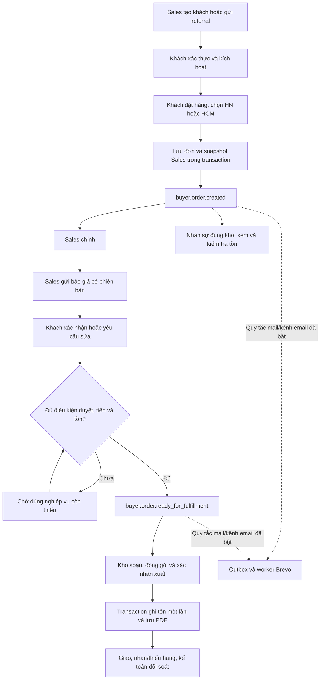

# Sales, referral, thông báo đúng kho và điều kiện xuất

Phạm vi lớn, gồm tài khoản, sở hữu khách, đơn Portal, RBAC, thông báo, tài chính và kho. Yêu cầu người dùng cho phép triển khai trực tiếp, kiểm thử riêng và production theo backup/rollback; không tạo khách/đơn thật hoặc gửi mail khách thật trong test.

## Task list và giao diện tích hợp

1. Tái sử dụng provisioning/lời mời; Sales chỉ cấp CUSTOMER/SUPERMARKET được gán cho mình, không có quyền accounts.manage hay mật khẩu.
2. Migration 050: referral server-side, primary owner riêng với partner_assignments, lịch sử chuyển giao bất biến, chống trùng và retry.
3. Migration 051: snapshot điều kiện duyệt/thanh toán và trạng thái soạn/giao; giữ nguyên hành vi đơn cũ, chặn tất cả đường xuất có liên kết đơn chưa đủ điều kiện.
4. Migration 052: snapshot Sales trên đơn mới, thông báo tức thì theo Sales/đúng kho, metadata sự kiện/dedup và email theo cấu hình hiện có.
5. UI Sales/Manager, referral QR nội bộ, đăng ký theo ref, đơn khách, bảng kho, chuông và danh sách thông báo riêng. Không bật lại toàn bộ các module đã nghỉ.
6. Kiểm thử các tình huống của yêu cầu trên LOCAL/STAGING, Edge và MCP; kiểm tra đơn DH-20261030-74735EC7 chỉ đọc.
7. Review code/RBAC/financial invariants; sau khi đạt kiểm thử, commit theo phần, backup và restore proof, triển khai SHA xác định, đối chiếu production + MCP.

## Quyết định đã khóa theo yêu cầu

- partner_assignments là quyền truy cập; owner là một Sales chính riêng biệt. Không backfill hoặc gán lại khách cũ hàng loạt.
- Đơn mới chụp Sales đang phụ trách; phân công lại chỉ thay quyền/đơn mới, giữ snapshot cũ.
- buyer.order.created chỉ thông báo và không ghi tồn. ready_for_fulfillment là sự kiện riêng sau đủ báo giá/xác nhận/duyệt/thanh toán/tồn theo chính sách.
- Nội bộ luôn nhận thông báo công việc ngay; email là kênh bổ sung, sự cố provider không làm mất đơn.
- Mã referral được xác thực server; account Sales khóa, mã hết hạn hoặc không hợp lệ phải báo lỗi, không tự gán người khác.
- Chuông/thông báo dùng module mới có scope, giữ các route generic đã retired trả 404.

Các kết quả và hướng dẫn sử dụng sẽ được bổ sung sau khi kiểm thử, không coi mô tả thiết kế là bằng chứng production.

## Chức năng và phạm vi dữ liệu

- Sales tạo hồ sơ và tài khoản CUSTOMER/SUPERMARKET qua lời mời đang dùng. Chỉ khách đặt mật khẩu trên trang kích hoạt; Sales không nhận mật khẩu hoặc token. Gửi mail lỗi vẫn giữ một hồ sơ chờ kích hoạt để xử lý lại có kiểm soát.
- Email, điện thoại và tên doanh nghiệp được chuẩn hóa để kiểm tra trùng. Trường hợp đã tồn tại chuyển sang hàng đợi đối chiếu của Admin/Manager, không tự lấy khách của người khác.
- Mỗi Sales có mã `SALE-…`, liên kết đăng ký và QR tạo trực tiếp trên server. Mã bị tắt/hết hạn hoặc Sales bị khóa phải báo lỗi. Referral chờ xác thực không có quyền truy cập khách qua API cũ trước khi kích hoạt.
- Một khách có một Sales chính. Quyền xem bổ sung qua `partner_assignments` được giữ riêng. Admin/Manager chuyển khách bằng phiên bản và lý do; gỡ quyền xem thông thường không âm thầm đổi Sales chính.
- Đơn mới lưu tên, email, membership Sales tại thời điểm tạo trong snapshot bất biến. Chuyển Sales chỉ thay xử lý hiện tại và đơn mới. Không backfill khách/đơn cũ, không gán khách cũ cho tài khoản demo.
- Đơn Portal tạo thông báo nội bộ cho Sales chính đang hợp lệ và nhân sự đúng kho được chọn. Quyền kho cụ thể ưu tiên trước vai trò mặc định theo vùng. Kho HN không nhận việc HCM và ngược lại; Admin/Manager xem tổng hợp qua bảng.
- Chuông, số chưa đọc, danh sách lọc sự kiện, đánh dấu đã đọc và liên kết chi tiết dùng module riêng có scope. Các module generic đã nghỉ vẫn được giữ trạng thái nghỉ.
- Báo giá dùng lại `buyer_orders`, lịch sử và bảng giá native. Sales thấy giá niêm yết/giá khuyến nghị; giá riêng, chiết khấu vượt hạn mức, điều kiện công nợ và ngưỡng tiền áp dụng quy tắc duyệt đang có. Báo giá sửa có phiên bản, đặt lại kết quả duyệt; không sửa đơn đã chốt.
- Kho thấy tiến độ báo giá, duyệt, tiền và tồn. Chờ báo giá không giữ/trừ tồn. Chỉ soạn/đóng gói/xuất khi backend đánh giá đủ điều kiện; tất cả đường xuất có liên kết nguồn được kiểm tra lại trong transaction.
- Kế toán xem giá/tiền nhận/còn nợ/VAT từ chứng từ gốc, kiểm tra tiền và đối chiếu ngân hàng theo quyền. Sales/Kho không được xác nhận tiền. Không tự thêm bước kế toán duyệt cho đơn mà chính sách không yêu cầu.
- VAT có thể có hai chữ số thập phân, tiền tính bằng số nguyên/basis points. Phí của bảng giá được giữ trên báo giá, thanh toán, PDF và chỉ tính một lần khi giao nhiều đợt.
- Dashboard lọc theo ngày/kho/Sales. Giá trị bán dựa trên phiên bản phiếu xuất đang xác nhận, trừ lượng trả thực nhận từ nguồn liên kết; đơn chỉ chấp nhận nhưng chưa xuất không tính tiền bán. Nhiều lần nhận/phân bổ tiền không nhân doanh số. Thống kê referral giữ nguồn giới thiệu; danh sách chi tiết vẫn chỉ hiện khách hiện được phân công.

## Luồng và người nhận thông báo

| Nhóm sự kiện | Người nhận nội bộ | Liên kết | Email |
| --- | --- | --- | --- |
| `customer.registered`, `customer.activated`, `customer.assigned_to_sales`, `customer.reassigned` | Sales được giao | Hồ sơ khách trong CRM | Tùy kênh cá nhân/quy tắc đã bật |
| `buyer.order.created` | Sales chính + nhân sự đúng kho | Chi tiết đơn CRM | Tùy cấu hình, không fallback người nhận |
| `quote_sent`, `quote_accepted`, `quote_rejected` | Sales chính + đúng kho + thành viên khách đang hoạt động | CRM hoặc Portal theo người nhận | Tùy cấu hình |
| `ready_for_fulfillment`, `picking`, `packed`, `shipped`, `delivered`, `delivery_failed`, `payment_confirmed`, `cancelled` | Sales chính + đúng kho + thành viên khách | Đúng chi tiết đơn | Tùy cấu hình |

`buyer.order.created` có cảnh báo chưa được xuất. `payment_confirmed` chỉ phát sinh từ nghiệp vụ xác nhận khoản tiền thật; kế toán cho phép công nợ không được diễn giải thành đã nhận tiền. Khi tồn được bổ sung sau khi khách chốt đơn, worker phát hiện lần đầu đơn đủ điều kiện và không phát thông báo trùng.

Thông báo nội bộ được lưu trong cùng transaction với nghiệp vụ, không phụ thuộc Brevo. Email thông báo gửi nội dung và liên kết; email PDF theo sự kiện xác nhận chứng từ hiện có. Worker giữ trạng thái `UNKNOWN` nếu không biết provider đã nhận hay chưa, không gửi lại mù.

## Phân quyền

| Vai trò | Khách, referral, báo giá | Kho/giao hàng | Thanh toán/VAT | Phân công |
| --- | --- | --- | --- | --- |
| SALES | Tạo khách; referral riêng; khách chính hoặc quyền xem được cấp; báo giá có lịch sử | Theo dõi, không ghi tồn | Chỉ xem theo scope; không xác nhận tiền | Không chuyển Sales |
| WAREHOUSE_HN | Xem đơn tại kho được cấp | Soạn/đóng gói/xuất sau đủ điều kiện, đúng kho | Không xác nhận tiền | Không |
| WAREHOUSE_HCM | Như trên, đúng phạm vi HCM | Như trên | Không xác nhận tiền | Không |
| ACCOUNTANT | Xem chứng từ và giá được chốt | Theo dõi/đối soát | Nghiệp vụ thu tiền, ngân hàng, công nợ, VAT theo quyền; không mở quyền duyệt chi/hạn mức | Không |
| MANAGER | Giám sát và xử lý báo giá theo quyền | Duyệt/ngoại lệ đúng chính sách | Nghiệp vụ hiện có theo quyền | Có, bắt buộc lý do/phiên bản |
| ADMIN | Quản trị | Quản trị trong invariant server | Quản trị | Có |
| CUSTOMER | Danh mục không giá; đơn và báo giá của tổ chức mình | Theo dõi giao | Tải chứng từ được cấp | Không |
| SUPERMARKET | Chi nhánh/hợp đồng B2B/đặt thùng của mình | Xác nhận nhận/thiếu theo phiếu thật | VAT, báo cáo/đối soát tháng của mình | Không |

MCP dùng principal Admin nội bộ hiện tại, không giả danh Sales hoặc khách để vượt các bước người nhận cần tự xác nhận.

## Migration và API

| Migration | Dữ liệu mới | Tương thích |
| --- | --- | --- |
| `050-sales-customer-ownership.sql` | Referral, primary ownership, lịch sử, yêu cầu xử lý trùng và retry/rate limit | Không gán lại dữ liệu cũ |
| `051-buyer-fulfillment.sql` | Snapshot chính sách, quyết định, tiến độ và lịch sử fulfillment | Đơn đã xác nhận cũ giữ luồng nguồn; đề nghị cũ chỉ nhận chính sách khi người dùng chủ động lập báo giá mới |
| `052-sales-order-notifications.sql` | Snapshot Sales đơn mới, metadata/dedup thông báo và index | Không sửa snapshot/phiếu cũ |
| `053-buyer-quote-price-checks.sql` | Kiểm tra bảng giá bất biến theo phiên bản báo giá, phí mặc định 0 | Không thay phí/hồ sơ cũ; báo cáo phí 0 giữ fingerprint đối soát cũ |

API mới:

- `GET /api/crm/sales-customers/{workspace,customer,referral,referral-qr,review-requests,notifications,fulfillment}`.
- `POST /api/crm/sales-customers/{create,referral,reassign,invite,read-notification,fulfillment}`.
- `GET /api/crm/sales-referrals/info?ref=…` và `POST /api/crm/sales-referrals/register` là đường đăng ký công khai có xác thực mã/rate limit, không phải công cụ Admin.
- `GET /api/crm/buyer/{warehouses,quote-pricing}` và `POST /api/crm/buyer/quote-revision`.

API cập nhật: buyer orders/detail/quote/confirm/receive/report, native xuất/giữ tồn, nghiệp vụ kế toán/finance và catalog MCP. Các lệnh kế toán ghi tiền yêu cầu UUID `idempotencyKey`; giao diện được cập nhật tương ứng.

## Trang và cách dùng

**Admin/Manager:** vào `/crm/sales-customers`, lọc khách/Sales/kho/ngày, chọn hồ sơ để phân công có lý do. Khách cũ chưa có Sales cần được chọn đúng người, không tự gán. Xem hàng đợi khách trùng để quyết định dùng hồ sơ hiện có. Quy tắc email được bật riêng trong cài đặt thông báo chứng từ; không tự thêm địa chỉ nhận.

**Sales:** mở “Khách hàng của tôi”, thêm khách và gửi lời mời. Theo dõi khách chưa kích hoạt, gửi lại/thu hồi lời mời khi cần. Tạo và sao chép referral/QR trong tab liên kết. Mở chuông hoặc “Đơn hàng của tôi” để báo giá; gửi phiên bản mới khi khách yêu cầu sửa. Báo giá có điều kiện duyệt vẫn phải qua người có thẩm quyền trước khi xuất.

**Khách:** mở referral, đăng ký, mở email đặt mật khẩu, đăng nhập `/portal`. Chọn kho/sản phẩm/số lượng; nhận và xác nhận báo giá hoặc gửi yêu cầu sửa. Chỉ xem đơn và chứng từ của tổ chức mình.

**Kho:** mở “Đơn hàng liên quan đến kho tôi”, lọc kho và tiến độ. Đơn mới chỉ kiểm tra tồn; khi hiện đủ điều kiện thì soạn/đóng gói và dùng luồng phiếu xuất hiện có. Backend vẫn kiểm tra lại điều kiện và số lượng thực xuất.

**Kế toán:** mở đơn để xem giá đã lưu, tiền đã nhận/còn nợ/VAT. Sử dụng màn hình thu tiền/ngân hàng và đối soát chứng từ hiện có. Chỉ đánh dấu điều kiện thanh toán phù hợp chính sách; thao tác này không tự tạo khoản tiền đã nhận.

## Kiểm chứng và giới hạn

Kết quả LOCAL hiện tại: acquisition 12 nhóm, routing/notification 9, metrics 9, fulfillment 16, finance 10, document flow 20, buyer 13 và OAuth/MCP 8 nhóm đạt. Acquisition/metrics có kiểm chứng PostgreSQL riêng; kết quả chính xác sau hợp nhất SHA và staging cuối sẽ ghi dưới đây. UI Edge 8 vai trò và production đang kiểm tra; chưa coi là hoàn thành.

- Không tạo tài khoản/đơn thật, không xuất hàng thật, không gửi mail khách thật để test.
- Mail mới được thử bằng provider giả có lỗi/retry; không dùng đó làm bằng chứng Brevo đã giao email mới tới hộp thư khách.
- Không phát lại thông báo lịch sử hoặc thao tác báo giá/chốt/xuất với `DH-20261030-74735EC7`; trước cập nhật: `WAITING_QUOTE`, v1, 7 dòng, chưa có phiếu giao.
- Không tự gắn khách cũ chưa có owner. Snapshot đơn cũ chưa ghi Sales được hiển thị đúng là chưa ghi nhận, không suy đoán từ Sales hiện tại.
- Bộ công cụ MCP đã qua runtime OAuth/SDK; thao tác trực tiếp trên giao diện ChatGPT web của người dùng chưa được thực nghiệm trong lần chạy này.

**MCP có dùng được không? MCP có đọc được dữ liệu này không?** LOCAL đã xác nhận dùng được và đọc được API/bảng nghiệp vụ mới, PDF và lịch sử. Khoá/mật khẩu/token, rate limit và receipt retry không được công khai. Kết quả production sẽ bổ sung sau triển khai SHA đã kiểm thử.

## Backup và rollback

Trước cutover: backup dữ liệu và source riêng, kiểm tra checksum, phục hồi thử vào database độc lập và xác nhận SHA hiện tại vẫn là tổ tiên của bản đưa lên. Giữ nguyên toàn bộ release cũ và lịch sử chứng từ.

Rollback thông thường giữ nguyên schema bổ sung và dữ liệu mới. Nếu người dùng đã tạo khách/đơn theo chính sách mới, cần dừng các luồng ghi liên quan trước khi chạy source cũ; không quay lại source thiếu chốt nghiệp vụ rồi tiếp tục xuất hàng. Không phục hồi đè bản backup lên dữ liệu mới trong lúc hệ thống còn nhận giao dịch.

File `db/crm/rollback/050-053-sales-empty-only.sql` chỉ dùng thủ công bằng DB owner, khi app đã dừng và đã có backup được phục hồi thử. Script chỉ cho rollback schema khi các bảng mới chưa có dữ liệu; chuyển bảng/hàm sang schema lưu trữ, giữ cột phí 0 dưới tên lưu trữ và cho phép migrate lên lại. Có dữ liệu referral, lịch sử, thông báo hoặc quy tắc mail liên quan thì từ chối, không xóa. Kiểm thử cục bộ đã xác nhận đi xuống/lên giữ nguyên identity cũ và từ chối khi đã có lịch sử.
